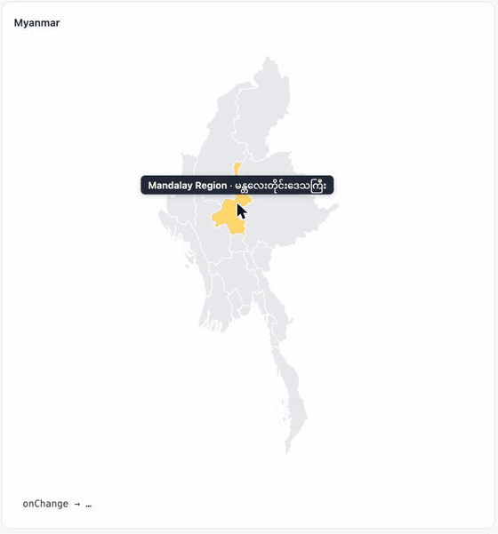

# @tm11/mmgeo-map — clickable map of Myanmar for React

[](https://www.npmjs.com/package/@tm11/mmgeo-map) [](https://bundlephobia.com/package/@tm11/mmgeo-map) [](https://tunmin11.github.io/mmgeo/#map)

Pick an address on a real map, from the whole country down to the **village tract or urban ward**.
Click a state, a district, a township, then a village tract, town or ward. Every click is a valid
answer, so you can stop at any level.

<p align="center">
  
</p>

- **Every level, with real boundaries:** 15 states and regions, 80 districts, 330 townships, 13,501
  village tracts, 498 towns and 1,955 wards, from MIMU's official boundaries.
- **No map library and no API key:** no tiles and no Leaflet or Mapbox. The map is plain SVG
  rendered by React.
- **Small to start:** the component is about 8 KB. States and districts load first (~80 KB gzipped);
  each township and village loads only when someone zooms in.
- **English and Burmese:** names, breadcrumb and screen-reader labels come in both languages.
- **Accessible:** every shape is a real button. Tab, Enter, Space and Escape work. It respects
  reduced motion.
- **Fits a form:** controlled `value`/`onChange`, matched to the codes of
  [`@tm11/mmgeo`](https://www.npmjs.com/package/@tm11/mmgeo) dropdowns, zod schemas and the database.
- **Works with any React setup:** React 16.8+, ESM and CommonJS, TypeScript types, and Next.js App Router
  (it ships `"use client"`).

**[Try it live →](https://tunmin11.github.io/mmgeo/#map)**

## Install

```bash
npm install @tm11/mmgeo @tm11/mmgeo-map
```

`@tm11/mmgeo` holds the data and boundaries; this package is only the component, so you can update
either one on its own.

## Quick start

```tsx
import { useState } from 'react';
import { MyanmarMap, type MapPlace } from '@tm11/mmgeo-map';

export function Picker() {
  const [place, setPlace] = useState<MapPlace | null>(null);
  return (
    <>
      <MyanmarMap value={place?.code} onChange={setPlace} height={520} />
      <p>{place ? `${place.name} (${place.level}, ${place.code})` : 'Pick a place'}</p>
    </>
  );
}
```

`onChange` receives the place that was clicked, with its English and Burmese names and every parent code:

```ts
{ level: 'village-tract', code: 'MMR017024039', name: 'Ma Gu', en: 'Ma Gu', mm: 'မဂူ',
  townshipCode: 'MMR017024', districtCode: 'MMR017D006', stateCode: 'MMR017' }
```

Store the `code`. It's a MIMU P-code, unique across the country, and a single code is enough to rebuild the whole address.

## Recipes

### Stop at townships (a typical address form)

```tsx
<MyanmarMap depth="township" onChange={p => p.level === 'township' && setTownship(p.code)} />
```

`depth` can be `'state'`, `'district'`, `'township'`, `'village-tract'` (village tracts and towns) or `'ward'`.
Add `skipDistrict` to go state → township directly.

### Map and dropdowns in sync

Both sides share one `useAddressCascade` from `@tm11/mmgeo/react`, so picking on the map fills the
dropdowns and picking a dropdown moves the map.

```tsx
import { useAddressCascade } from '@tm11/mmgeo/react';
import { MyanmarMap, type MapPlace } from '@tm11/mmgeo-map';

function AddressField() {
  const a = useAddressCascade({ lang: 'mm' });
  const fromMap = (p: MapPlace) => {
    if (p.level === 'state') a.setState(p.code);
    else if (p.level === 'district') a.setDistrict(p.code);
    else if (p.level === 'township') a.setTownship(p.code);
  };
  return (
    <>
      <MyanmarMap
        depth="township" lang="mm"
        value={a.value.townshipCode ?? a.value.districtCode ?? a.value.stateCode}
        onChange={fromMap}
      />
      {/* your <select>s for a.states / a.districts / a.townships */}
    </>
  );
}
```

### "Use my location"

`placeAt` from `@tm11/mmgeo/boundaries` finds the exact ward, town or village tract containing a
point (accurate to about 40 m in villages and 10 m for wards). It loads only the outlines it needs.

```tsx
import { placeAt } from '@tm11/mmgeo/boundaries';

navigator.geolocation.getCurrentPosition(async ({ coords }) => {
  const place = await placeAt(coords.latitude, coords.longitude);
  if (place) setCode(place.code); // e.g. 'MMR013010701510', No (11) Ward in Yankin
});
```

### One area only

For an app that only serves one city, district or state, `root` starts the map there and never zooms out
past it:

```tsx
<MyanmarMap root="MMR013" />             {/* Yangon Region */}
<MyanmarMap root="MMR013D002" />         {/* Yangon (East) District */}
<MyanmarMap root="MMR017024" />          {/* Bogale Township: its 77 village tracts */}
```

### Your brand colours and dark mode

```tsx
<MyanmarMap
  colors={{ fill: '#1E293B', stroke: '#0F172A', hover: '#38BDF8', selected: '#F472B6',
            context: '#111827', text: '#E5E7EB', tooltip: '#F8FAFC', selectedText: '#0F172A' }}
/>
```

Any colour you don't set keeps its default. `className` and `style` go on the wrapper.

### Your data on the map

Colour places by your own numbers (a choropleth) and show them on hover. You choose the colours;
`fill` returning `undefined` keeps the default.

```tsx
const users: Record<string, number> = { MMR013: 1240, MMR010: 860 };
const shade = (n?: number) => n === undefined ? undefined : n > 1000 ? '#1D4ED8' : n > 500 ? '#60A5FA' : '#BFDBFE';

<MyanmarMap
  fill={p => shade(users[p.code])}
  tooltip={p => `${p.name}: ${users[p.code] ?? 0} users`}
/>
```

Need smooth scales or a legend? Use `d3-scale` (or any) inside `fill` and draw the legend yourself.

### Burmese and labels

```tsx
<MyanmarMap lang="mm" showLabels />
```

Names always appear in a popover on hover and keyboard focus. `showLabels` also writes them on shapes
that are big enough.

### Validate on the server

The codes are the same ones `@tm11/mmgeo/zod` checks, so the server can trust what the map sent:

```ts
import { mmAddressCodes } from '@tm11/mmgeo/zod';
mmAddressCodes.parse({ stateCode: 'MMR013', districtCode: 'MMR013D002', townshipCode: 'MMR013010' });
```

## Props

| Prop | Default | |
|---|---|---|
| `value` / `defaultValue` | — | Selected code at any level. Controlled when `value` is given. |
| `onChange` | — | `(place: MapPlace) => void`, called with the place clicked: state, district, township, village tract, town or ward. |
| `depth` | finest available | Deepest level users can pick: `'state'`, `'district'`, `'township'`, `'village-tract'`, `'ward'`. |
| `skipDistrict` | `false` | Go state → township. |
| `root` | — | Keep the map inside one state, district, township or town. |
| `context` | `'faint'` (`'hidden'` with `root`) | Show neighbouring areas greyed out, or hide them. |
| `lang` | `'en'` | `'en'` or `'mm'` for names, breadcrumb and accessible labels. |
| `height` | `480` | Map height (number in px, or any CSS length). |
| `showLabels` | `false` | Also draw names on shapes big enough to hold them. |
| `colors` | | `fill`, `hover`, `selected`, `stroke`, `context`, `text`, `selectedText`, `tooltip`, `focus`. |
| `fill` | | `(place: MapPlace) => string \| undefined`. Colour shapes from your data; hover and selected still win. |
| `tooltip` | | `(place: MapPlace) => ReactNode`. Popover content; default is the English and Burmese names. |
| `className` / `style` | | Passed to the wrapper. |
| `aria-label` | `'Map of Myanmar'` (Burmese with `lang="mm"`) | Accessible name of the map. |

Types: `MyanmarMapProps`, `MyanmarMapColors` and `MapPlace` are exported.

## How it behaves

- **Navigation:** click or press Enter or Space to pick a shape. If it has places inside, the map zooms in.
  The breadcrumb or Escape goes back up.
- **Loading:** states and districts come with `@tm11/mmgeo/boundaries`. A state's townships, and a
  township's village tracts, towns and wards, are separate files of 5–70 KB each. They load the first time
  someone zooms in, while a "Loading…" status shows. Bundlers that support dynamic `import()`
  (Vite, webpack, Next.js, esbuild, Rollup) split them into chunks automatically. If a load fails, an error
  shows and the next zoom tries again.
- **Coverage:** 330 of the 356 townships in the data have an outline. The other 26, mostly in the Wa and
  Kokang areas, have no separate boundary in MIMU's boundary release, so they can't be picked on the map;
  use a dropdown for them. 175 village tracts and 44 wards also have no outline in boundary release v9.4.

## Data and license

Boundaries: [MIMU](https://themimu.info) administrative boundaries v9.4, via OCHA's
[Myanmar COD-AB](https://data.humdata.org/dataset/cod-ab-mmr), CC BY-IGO 3.0. Show a credit
such as *"Boundaries: MIMU (themimu.info), CC BY-IGO"* near the map. Names and codes: MIMU P-codes 9.7.
See [`DATA_LICENSE`](https://github.com/tunmin11/mmgeo/blob/master/DATA_LICENSE). The boundaries
and names shown do not imply official endorsement or acceptance by the United Nations.

Component code: ISC.

## Developing

From the repo root, `npm run demo` starts the playground at http://localhost:8000 (`?hero` shows a
single map), `npm test` runs both packages' tests, and `npm run build` builds both. Inside the repo,
`@tm11/mmgeo` resolves to the source in `../../src`.
